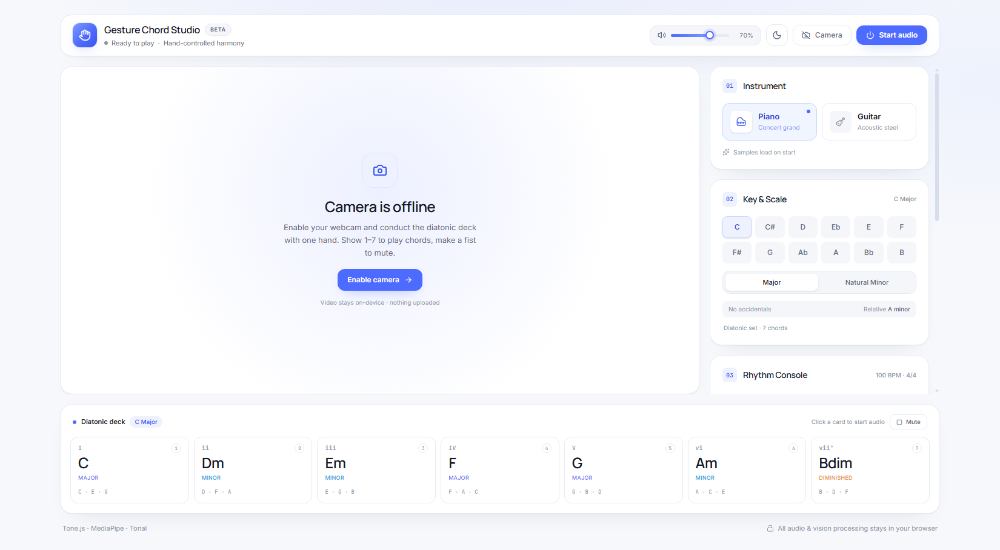
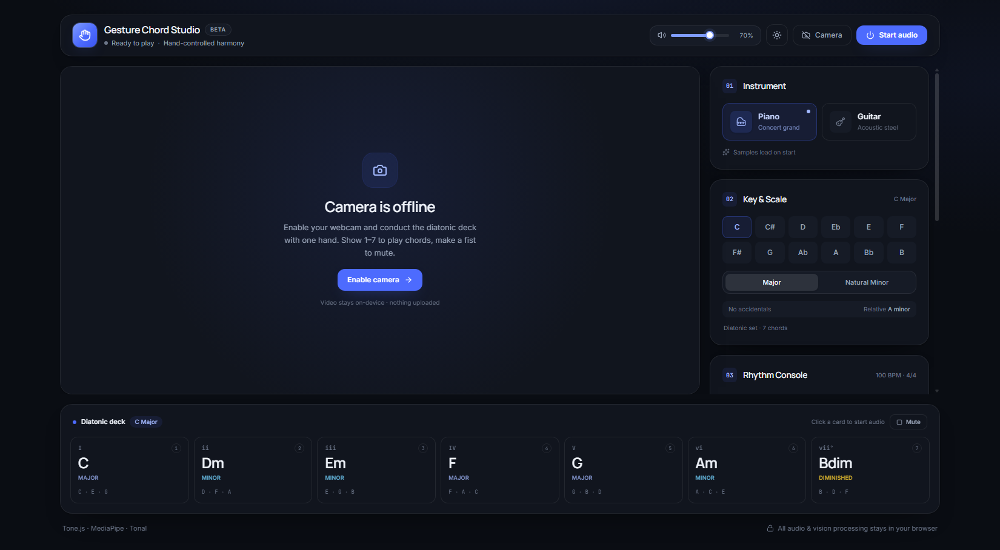

# Gesture Chord Studio

Hand-controlled diatonic harmony in the browser. Show **1–7** with one hand to play the seven diatonic chords of the selected key, make a fist to mute, and shape the groove with four rhythm patterns.

A pure static SPA — camera frames, gesture inference and audio synthesis all run locally.

| Light | Dark |
| --- | --- |
|  |  |

## Features

- **Vision** — MediaPipe `HandLandmarker` with a 21-landmark skeleton overlay, mirrored video, GPU delegate and automatic CPU fallback.
- **Gestures** — geometric classifier for 1–7 and fist (0), confirmed over 5 consecutive frames to prevent jitter.
- **Harmony** — 12 roots × major / natural minor, with Tonal-powered diatonic triads, roman numerals and playable voicings.
- **Instruments** — sampled concert grand piano (Salamander) and acoustic guitar (`tonejs-instruments`), plus instant synth fallbacks while samples load or when offline.
- **Rhythm** — Tone.js Transport with 4/4, 3/4 and 6/8 meters, beat lights, optional metronome, and four modes: trigger once, block loop, arpeggio and strum.
- **Interface** — DeepSeek-inspired light/dark theme, persisted preference and system-theme detection.
- **Shortcuts** — `1`–`7` play chords, `0` / `Esc` releases.

## Stack

- Vite 8 + React 19 + TypeScript 6
- Tailwind CSS 4 (`@tailwindcss/vite`)
- `@mediapipe/tasks-vision`
- Tone.js + Tonal
- lucide-react

## Run locally

```bash
npm install
npm run dev
```

Open [http://localhost:5173](http://localhost:5173), click **Start audio**, then **Enable camera**. Browsers require HTTPS or localhost for camera access and a user gesture before audio can start.

### Local assets

The MediaPipe WASM runtime and the hand landmarker model are bundled under `public/wasm` and `public/models/hand_landmarker.task`, so vision setup works without network access. A CDN fallback is attempted if the local assets cannot load.

Sample banks are fetched from public CDNs on first use; the built-in synth fallback covers offline use.

## Scripts

```bash
npm run dev      # development server
npm run build    # type-check + production build
npm run preview  # preview the dist build
npm run lint     # oxlint src
```

## Notes

- On desktop the right control panel scrolls independently while the video stage, transport and chord deck stay in place.
- Gesture thresholds can be tuned in `src/services/gestureClassifier.ts` for different lighting and camera setups.
- All processing is client-side; no camera frames or audio are uploaded.
- MediaPipe assets and third-party sample banks retain their respective licenses.
